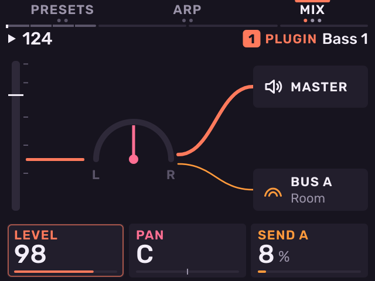
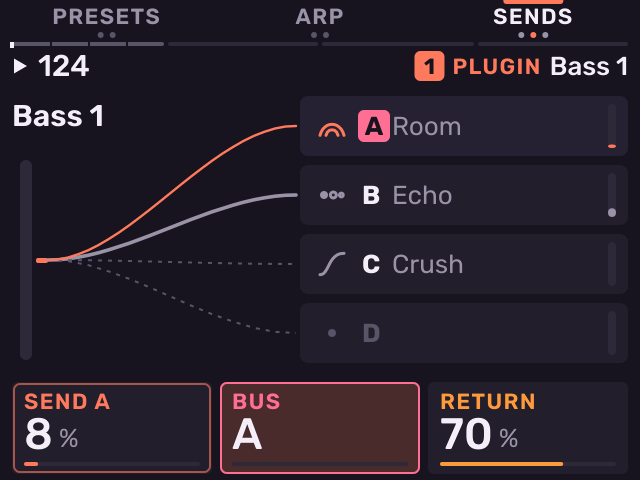
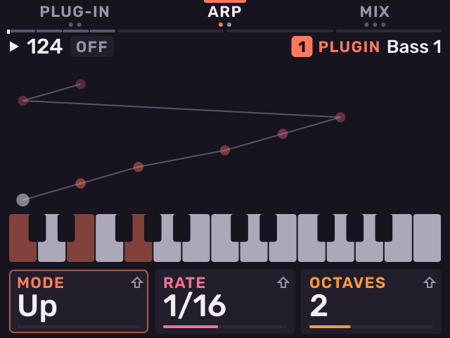
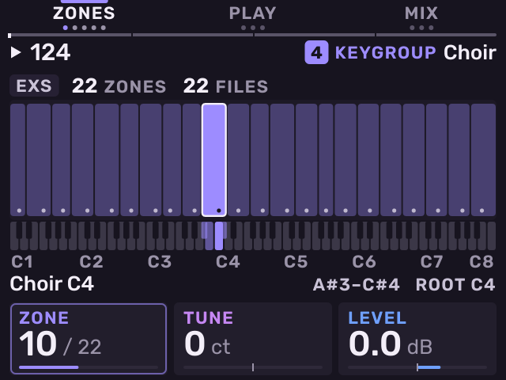
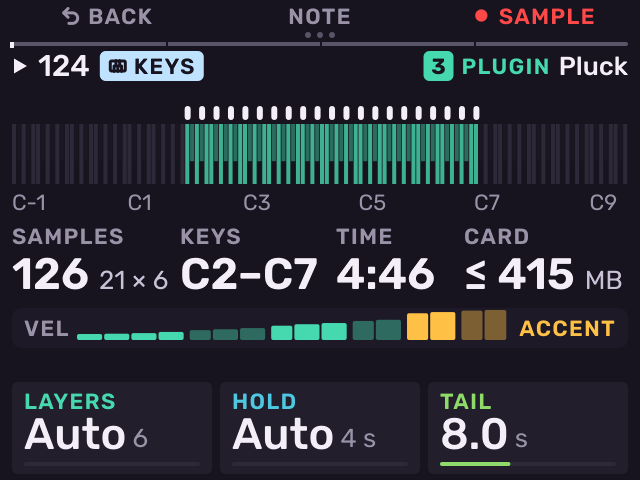
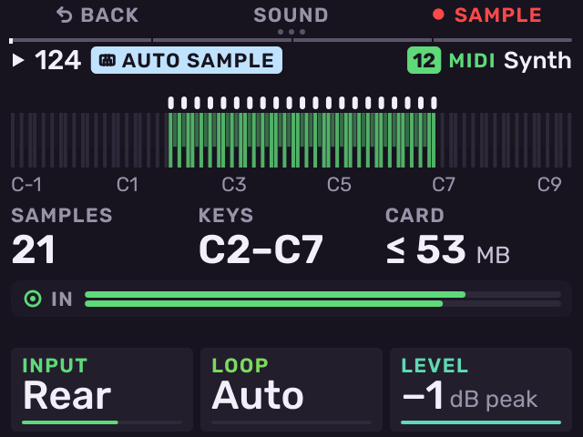
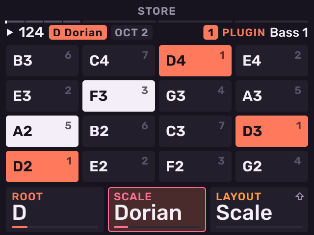
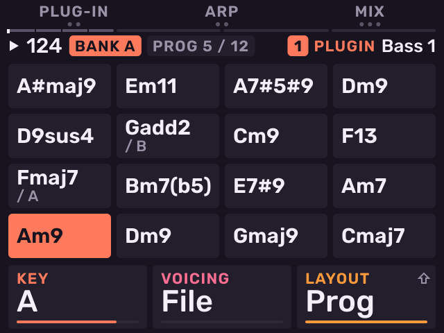
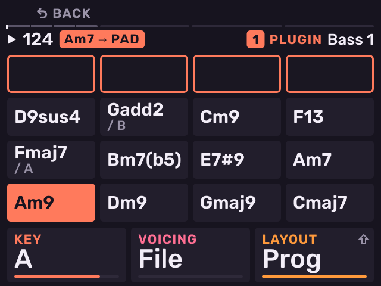

# Instrument and MIDI tracks

Previous: [Plug-ins](plug-ins.md) · [Contents](../GUIDE.md) · Next: [Sequencing](sequencing.md)

## Stage on a plug-in track

| Key | Pages |
| --- | --- |
| **B1** | **PRESETS** (or **PLUG-IN**), **EDIT** |
| **B2** | **ARP**, **CHORD** |
| **B3** | **MIX**, **SENDS**, **FX** |

**PRESETS**: the plug-in's presets. The name of the one playing is large,
with the ones before and after it in the corners. Turn the encoder to load
the next one; it loads when you stop turning. Push the encoder for the whole
list. A plug-in with no presets shows **PLUG-IN** instead: its name, its
format and how much of each audio block it uses.

**K1**–**K3** are the same three knobs on every plug-in, applied to what it
plays:

- **K1** (**FILTER**): left of the middle a low pass, right of it a high
  pass, off in the middle.
- **K2** (**ECHO**): how much goes into a dotted-eighth echo at the tempo.
- **K3** (**SPACE**): how much goes into a reverb.

The echo's repeats and the reverb's tail ring on when you turn their knob
back. The knobs are saved with the track and record as Motion. **ERASE** +
knob sets one back to off.

**EDIT**: all of the plug-in's parameters, as on the Edit page. Turn the
encoder or press **−** / **+** to move through them.

**MIX**: **K1** level, **K2** pan, **K3** send to bus A.

**SENDS**: **K1** selects bus A–D, **K2** sets the send to it, **K3** the
bus return. The picture shows the four buses and each bus's first effect.

**ARP**: **K1** mode (Up, Down, Up-down, Random, Order), **K2** rate (1/4 to
1/32T), **K3** octaves. **SHIFT** + **K1** gate, **SHIFT** + **K2** turns the
arpeggiator on or off, **SHIFT** + **K3** hold. The arpeggiator is separate from
**NOTE REPEAT**: Note Repeat plays every pad held together on each step.

**CHORD**: one pad plays a chord from the scale. **K1** type (Triad, Dia 7,
Sus2, Sus4, Power, Dia 9), **K2** voicing (Close, Open, Drop 2, Spread),
**K3** inversion. **SHIFT** + **K1** turns chords on or off. **SHIFT** +
**K3** hold.

**FX**: the track's effect chain. The cards edit the selected slot. Push the
encoder for the next slot. With no effects, push opens the effect picker.

## Keygroup tracks

A keygroup track plays one instrument across its pads and keys: an SFZ, an
MPC keygroup program, an EXS, a DecentSampler preset, a SoundFont preset, or
a single sample. Its pads play notes, as on a plug-in track.

To make one: select an empty track, turn to **Keygroup** and push the
encoder. Pick the instrument or sample in the browser. **SAMPLE SELECT** on
the track opens the browser again to change it.

| Key | Pages |
| --- | --- |
| **B1** | **TRIM** (**ZONES** on an instrument), **TUNE**, **AMP ENV**, **FILTER**, **FILT ENV** |
| **B2** | **PLAY**, **ARP**, **CHORD** |
| **B3** | **MIX**, **SENDS**, **FX** |

**TUNE** moves every note. A single sample plays its own pitch on C4 (note 60).

The fader starts on the sound's volume and can take pitch bend. A MIDI
keyboard's pitch wheel and sustain pedal play it too.

In an MPC 3 export a keygroup track is an MPC keygroup track, and an MPC 3
project's keygroup tracks open as keygroup tracks.

### Auto sample a plug-in

Auto sample plays a plug-in track one key at a time and records each note.
The result is an MPC keygroup program on a new keygroup track, which takes
almost no CPU and opens on MPC One, Live, Key, X, Force and MPC Beats.

1. Select the plug-in track and set the sound you want.
2. Press **SHIFT** + **Pad 11** (Resample). **SHIFT** + **Pad 11** again closes the sheet.
3. Wait for the check (**CHECKING**, a few seconds). It plays a few notes and
   finds out what the plug-in is.
4. Set the cards. **B2** (or the encoder) shows the next row.
5. Press **B3 SAMPLE** (or push the encoder).

| Row | K1 | K2 | K3 |
| --- | --- | --- | --- |
| **KEYS** | **LOW**: lowest note | **HIGH**: highest note | **STEP**: semitones between notes |
| **NOTE** | **LAYERS**: velocity layers, 1–4 | **HOLD**: how long each key is held, or Auto | **TAIL**: longest release measured |
| **SOUND** | **TAP**: Pre FX or Post FX | **LOOP**: Auto, On or Off | **LEVEL**: as played, or loudest at −1 dB |

The pads play the plug-in so you can try the sound first; **−** / **+** move
their octave. While it samples, the marks over the keys light as each note is
done, and the note being recorded is drawn as it plays: the held part, then
the release. **B1 CANCEL** stops it and deletes what was made.

When it is done, the program is in **Samples/Keygroups/<name>/** and the first
empty track becomes a keygroup track with the plug-in track's patterns, Song
clips, mix and pitch bend. With **TAP** at Pre FX it also gets the plug-in
track's effects (not plug-in effects); at Post FX the effects are in the
samples. The plug-in track stays as it was. **SHIFT** + **−** undoes the new
track; the files stay on the card.

The check sets these for you; the sheet's chip shows the type:

| Found | What Auto sample does |
| --- | --- |
| **KEYS** | Samples every **STEP** keys, as set. |
| **MONO** | The program plays one note at a time and glides like the plug-in (**GLIDE** shows the time). |
| **DRUMS** | Samples each key that makes a sound, one sample per key. **STEP** is not used. Each drum plays whole however short the tap. |
| **ACCENT** | The velocity layers split where the sound jumps (two layers at least). |
| **TAKES ×3** | Each key is recorded three times and the program plays them in turn. |
| **LOOPS** | The sound keeps sounding while a key is held, so each note loops and plays on for as long as you hold the pad. With **LOOP** at Auto this follows the check; set it to On or Off to choose yourself. |
| **HOLD Auto** | A steady sound is held 2 s. A sound that moves while held (a slow LFO, detuned oscillators) is held 8 s and gets a long loop, so its movement carries on. A sound that fades is held until it has died away. |

On a keygroup track from a **MONO** program, a key pressed while another is
held glides to the new note without starting it again. A **Slide** step does
the same on any keygroup track. The glide is saved in the program, so it also
works on an MPC and in MPC 3 exports.

- Each key covers the notes halfway to the next sampled key.
- **LOOP** finds a loop in the held part of each note and crossfades it, so
  pads and organs sustain. Sounds that move while held get a loop several
  seconds long. Sounds that fade while held (plucks, a 303) are not looped at
  Auto; put **LOOP** On to hold them.
- When you let a key go, the note fades as the plug-in's did: Auto sample
  measures how fast the plug-in falls and how much of it rings on (echoes,
  reverb), and sets the program's release to match. A sound that rings on
  plays as two keygroups over the same keys, one with the short release and
  one with the long.
- **LEVEL** at −1 dB raises every sample by the same amount, so velocity
  layers keep their balance.
- A key where the plug-in makes no sound is left out.

### Auto sample an external instrument

Auto sample also works on a MIDI track. Melodee plays the instrument over
MIDI and records its sound from an input. This runs in real time: each note
plays for its hold and its release.

1. Connect the instrument: MIDI from the MPC (the MIDI Out jack or USB) and
   its audio to the rear inputs.
2. Select the MIDI track and play the pads to check that the instrument
   answers.
3. Press **SHIFT** + **Pad 11** (Resample).
4. On the **SOUND** row, set **INPUT** (**K1**) to the input the instrument
   is on: Rear, Rear L, Rear R, Mic or USB. It starts at Rear.
5. Play a pad and watch the **IN** meter. Amber is close to clipping: turn
   the instrument down.
6. Set the other cards as for a plug-in and press **B3 SAMPLE**.

Melodee first listens to the input with nothing playing, then plays one
short note to measure how long the instrument takes to answer. The check
(**CHECKING**) and the sampling follow in one go. Each sample starts where
its sound starts.

- Do not play the instrument while it samples. Pressing **PLAY** stops it.
- **INPUT** is the track's own audio input (the **AUDIO** page in Edit), so
  you hear the instrument through the track. Input Config's source is not
  used and does not change; its gain applies.
- **No sound at the input**: check the cables, the MIDI channel and
  **INPUT**.
- **The input is not quiet**: something is sounding or humming at the input
  before the first note.
- **The input clips**: turn the instrument down and sample again.
- The program goes on the first empty track as a keygroup track with the
  MIDI track's patterns. The MIDI track stays as it was.

## Keys

Hold **SAMPLE** on an instrument track to see **Keys**. The 16 pads fill the
screen. Each pad shows its note and its degree in the scale. Root notes are
in the track's colour. While you hold **SAMPLE**, **K1** sets the root, **K2**
the scale and **K3** the pad layout.

- **K1**: root. **K2**: scale. **K3**: layout (Scale, Chromatic, Chords,
  16 Levels, Drums or Prog). Drums lays the pads out as a kit's; see
  [Drum machine plug-ins](plug-ins.md#drum-machine-plug-ins). Prog plays
  chord progressions; see [Chord progressions](#chord-progressions).
- **−** / **+**: octave.
- **SHIFT** + **K3**: transpose the pads −12 to +12 semitones.
- Encoder push: open Edit.

The key and scale belong to the project. The layout belongs to each track.

## Chord progressions

The **Prog** layout plays a chord progression: each pad plays one chord.
Melodee reads MPC 3 progression files (`.progression`). A progression has up
to 48 chords, 16 in each of pad banks A to C.

1. Hold **SAMPLE** on an instrument track to see **Keys**.
2. Turn **K3** to **Prog**.
3. Turn the encoder to select a progression. Its name shows on the screen.
4. Play the pads. Press **PAD BANK** for banks B and C.

The chord marked as the root in the file is in the track's colour. A pad
with no chord is dark.

| Control | Action |
| --- | --- |
| Encoder | Select the progression |
| **K1** | Key. All chords move to the new key. |
| **K2** | Voicing: File (as in the file), Close, Open or Spread |
| **K3** | Layout |
| **−** / **+** | Octave |
| **PAD BANK** | Banks A–C |

Melodee looks for progressions in these folders on the SD card:

- `Melodee/Progressions` (your own progressions)
- `Progressions`
- `Samples/Expansions` (in each expansion's folders)

### Make your own chords

1. On **Keys**, set **K3** to Scale, Chromatic or Chords.
2. Hold the pads of the chord. **B2** shows **STORE**.
3. Press **B2**. The layout changes to **Prog**. Empty pads are outlined.
4. Press the pad for the chord. To cancel, press **B1** (**BACK**).

Melodee saves the progression to `Melodee/Progressions` on the SD card. A
new progression is named Mine 1, Mine 2 and so on. When you add a chord to a
progression from another folder, Melodee saves the changed copy in
`Melodee/Progressions` and does not change the original file.

The project keeps the progression of each track, its key and its voicing.

## MIDI tracks

A MIDI track sends its pads, patterns and arpeggiator to an external
instrument on its own port and channel.

| Key | Pages |
| --- | --- |
| **B1** | **DEVICE**, **PROGRAM**, **CC** |
| **B2** | **ARP**, **CHORD** |
| **B3** | **EDIT**: opens the Edit pages (below). |

**DEVICE**: **K1** port (the MIDI Out jack, USB-C, all USB devices, or a
USB device by name), **K2** channel. The picture shows the notes going out.

**PROGRAM**: bank MSB, bank LSB and program number. Melodee sends them
when they change and when the track loads.

**EDIT** (**B3**): every page of the MIDI track: device, program, eight
pages of slots, the drum map (**PADS**), expression, audio in and SysEx.
Press **SAMPLE** to go back to Stage.

**CC**: three MIDI CCs on **K1**–**K3**. **SHIFT** + knob selects the CC
number. Knob moves record as Motion.

Edit on a MIDI track has more pages: eight **SLOTS** pages with 24 knobs
(CC, 14-bit CC, pitch bend, channel pressure or NRPN), **EXPRESS** (pitch
bend and pad pressure), **PADS** (Keys or Drums with General MIDI drum
names), **AUDIO** (route an input into the track's mixer strip) and
**SYSEX** (send a `.syx` file from the `SysEx` folder on the card).
**SHIFT** + **Pad 11** samples the instrument into a keygroup program; see
[Auto sample an external instrument](#auto-sample-an-external-instrument). For
how MIDI tracks were designed, see the
[MIDI tracks design notes](../MIDI_TRACKS.md).

---

Previous: [Plug-ins](plug-ins.md) · [Contents](../GUIDE.md) · Next: [Sequencing](sequencing.md)
