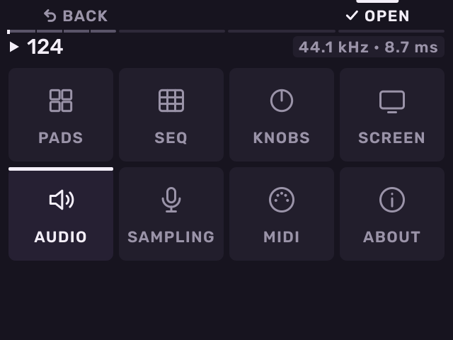
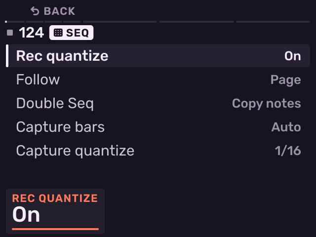
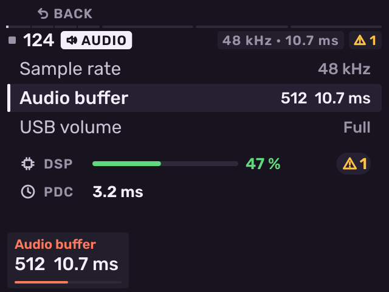
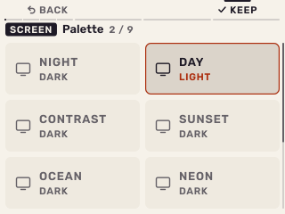
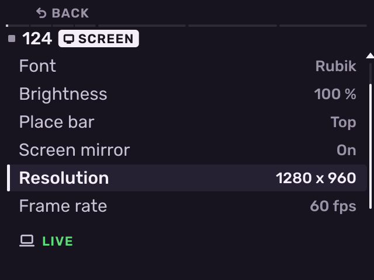

# Settings

Previous: [Projects and files](projects-and-files.md) · [Contents](../GUIDE.md) · Next: [Exit and troubleshooting](exit-and-troubleshooting.md)

Press **SHIFT** + **Pad 8**. Turn the encoder to a page and push it (or
press **B3**, **OPEN**) to open it. **B1** goes back.

On a page, turn the encoder to a row and push to open it. Turn the encoder
to change it and push again to keep it. **−** / **+** change the row under
the cursor at once. A page with more rows than the screen holds scrolls: a
bar at the right edge shows where you are, with an arrow at the top or
bottom while more rows are that way. The header shows the sample rate and buffer the audio
runs at, and in amber the audio dropouts since Melodee started.

| Page | Settings |
| --- | --- |
| **PADS** | Pad response (soft, medium, hard, full level), pad pressure, Repeat velocity (Strike: every repeat as hard as the pad was struck; Pressure: as hard as the pad is held), pad lights (track colours, white, off), **Pad fade** (how fast a pad's light fades after its sound stops: 60, 100, 150 or 250 ms), **Tap Tempo light** (flashes on the beat while playing, on or off) |
| **SEQ** | **Rec quantize** (as **SHIFT** + **Pad 10**), **Follow** (Step Edit and Roll while the pattern plays: Off, Page or Step; see [Sequencing](sequencing.md)), what Double Seq copies, Capture length and grid |
| **KNOBS** | Knob, Knob FX and fader takeover: Pickup, Scaled or Instant |
| **SCREEN** | **Palette** and **Font** (see below), **Brightness** (20 to 100 %), place bar at the top or bottom, Screen mirror (on or off) and its resolution: the screen as a USB camera for a computer |
| **AUDIO** | Sample rate (44.1, 48 or 96 kHz) and audio buffer (256 to 1024 frames). A longer buffer gives fewer crackles on a busy project. A shorter one responds sooner. |
| **SAMPLING** | Audio Recall settings, when a Free take ends on its own, and the level that counts as silence (**Silence below**) |
| **MIDI** | MIDI Config (see [MIDI and sync](midi-and-sync.md)) |
| **ABOUT** | How the MPC is doing: processor load, audio dropouts, card space, plug-in load. **B3** shows the version and what Melodee is built on. |

Settings are the same for every project. A sample rate change stops
playback for about a second while the audio restarts.

## Basic and Full

On the first Settings page, **K1** (**FEATURES**) switches between **Basic**
and **Full**. A new install starts on Basic. An MPC that already had
Melodee's settings stays on Full.

**Full** shows every page. **Basic** shows the stock app's pages plus
tracks, plug-ins, the mixer and Song. Nothing is deleted or changed by the
switch: what a project holds keeps playing, and Full shows it again.

| Area | Basic leaves out |
| --- | --- |
| The MENU's **GO** | **MOTION**, **SENDS** and **LOOPER**. The other places keep their pads. |
| **SEQ** | **B3** (**MOTION**, **MOD**, **MACRO**), unless the pattern holds Motion. Follow actions and **VARY**. |
| The mixer | **B2** (**SENDS**). Tracks keeps level, pan and send A. |
| A kit pad's **SAMPLE** pages | **LAYERS**, **COLOUR**, **FOLLOW**, **CLOUD**, **SENDS** and **KIT FILT**. The stock app's seven pages stay: Trim, Tune, Amp Env, Play, Mix, Filter, Filt Env. |
| Other tracks' **SAMPLE** pages | **SENDS** |
| A new track | **MIDI** and **Audio**. Drum, Keygroup and Plugin stay. |
| **LOOP** | The Looper: **LOOP** held and **LOOP** + **16 LEVELS**. A tap of **LOOP** still loops the last pad. |

These still work in Basic by their own keys: Step Edit's **TRIG** and
**EUCLID** cards, freeze (**SAMPLE RECORD** on a plug-in track), the auto
sampler, a sample's stems (**SHIFT** + **B3** on **TRIM**), stems and MPC
export on Song, the buses' effect chains.

## Palette and Font

In **SCREEN**, press **Push** on **Palette** or **Font** to show the choices
as cards. Turn the **Data** wheel (or press **−**/**+**) to move between
them. The whole screen changes as you go, so you see each one on the page.
Press **Push** or **B3 KEEP** to keep it, or **B1 BACK** to go back to the
one you had.

Palettes: NIGHT (the default), DAY, CONTRAST, SUNSET, OCEAN, NEON, CANDY,
LO-FI and LCD. LCD looks like an old sampler's backlit LCD: dark letters on a
grey-green screen, no colour, always in the Melodee Pixel font. Each track keeps its colour family in every palette, so track 1 is
always coral; on DAY and CANDY the colours are darker so they read on the
light screen. The pads keep their own colours.

Fonts: Rubik (the default), Inter Tight, Atkinson, Space Grotesk, IBM Plex
and Manrope, and two pixel fonts: Melodee Pixel and VT323. Melodee Pixel is
drawn only at whole sizes of its grid, so its edges stay sharp.

## Screen Mirror

In **SCREEN**, with **Screen mirror** on, a computer connected by USB-C sees the MPC as a
camera named **MPC Sample**. Choose it in any camera app (QuickTime Player,
OBS, a video call) to show the screen. Macs, Windows and Linux computers
and iPads with USB-C take it; iPhones do not take USB cameras.

**Resolution** sets the picture size the computer gets, and **Frame rate**
how many pictures a second (30 or 60). Each size is the screen scaled up by
a whole number, so its pixels stay sharp squares:

| Resolution | Scale | 30 fps | 60 fps |
| --- | --- | --- | --- |
| 320 x 240 | 1 | uncompressed | uncompressed |
| 640 x 480 | 2 | uncompressed | JPEG |
| 1280 x 720 | 3, black bars at the sides | JPEG | JPEG |
| 1280 x 960 | 4 | JPEG | JPEG |

Uncompressed pictures are exact to the pixel; JPEG is used where USB could
not carry them uncompressed. The pictures go out evenly spaced, about two
frames behind the MPC's screen. If the picture looks soft in an app, pick a
larger size: the app then stretches it less.

Under the rows while it is on: **READY** (the computer has the camera), **LIVE** (an app
shows it), **CARD MOUNTED** (the camera pauses while the card is mounted on a computer,
and comes back after). USB audio, MIDI and the network drop for
about a second when you turn it on or off or change the resolution.

The MPC never unplugs the camera while an app shows it. Turning it off or
changing the resolution or frame rate then waits, with **IN USE** under the rows, until
you close the camera in that app. SD card access says **CAMERA IN USE**
and does not start, and a new sample rate reaches the computer once the
camera is closed. If Melodee restarts while an app shows the camera, the
picture stops for a moment and then goes on.

---

Previous: [Projects and files](projects-and-files.md) · [Contents](../GUIDE.md) · Next: [Exit and troubleshooting](exit-and-troubleshooting.md)
